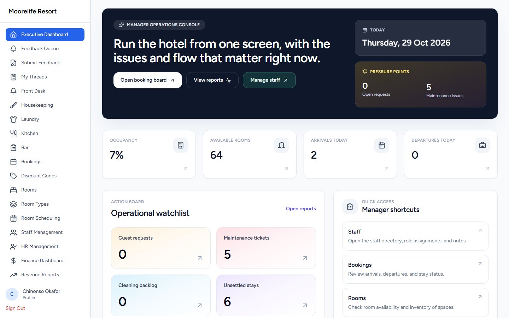
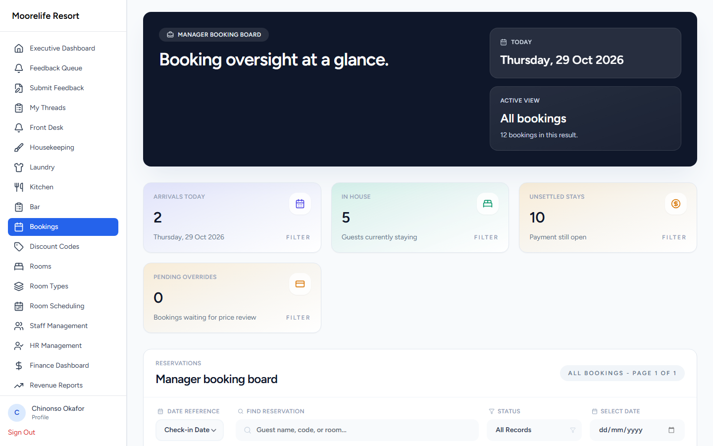
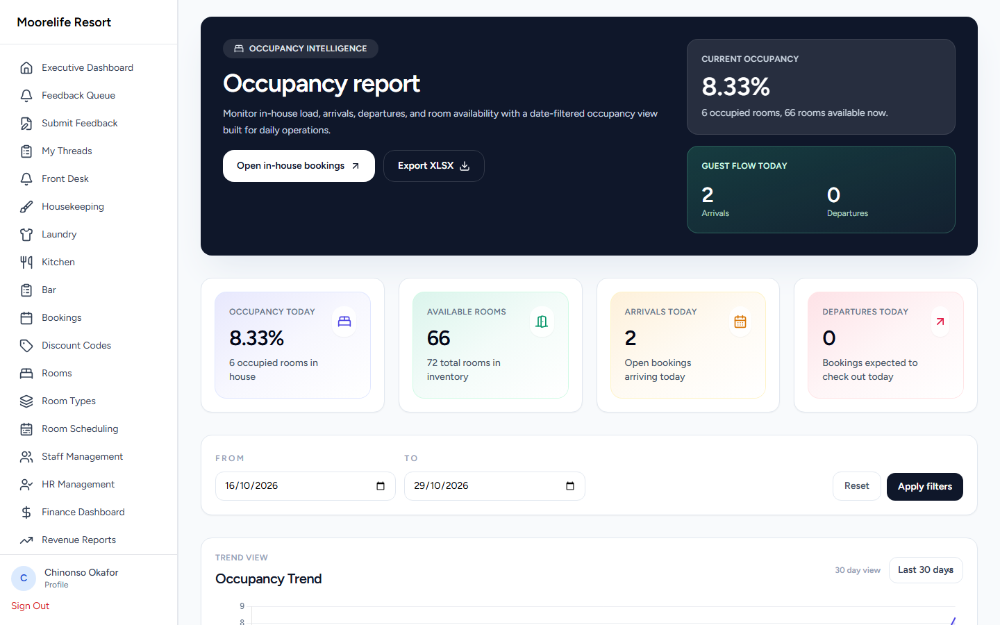
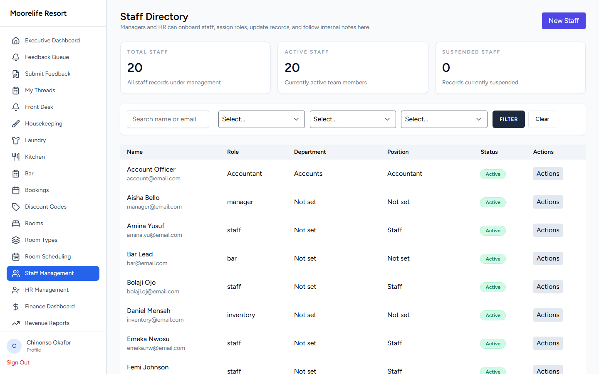
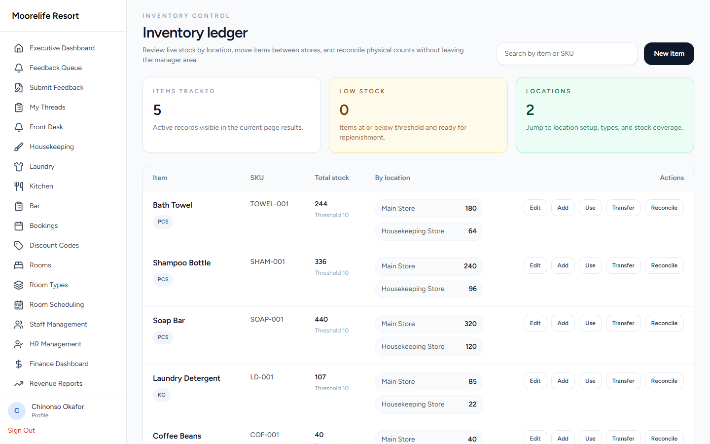
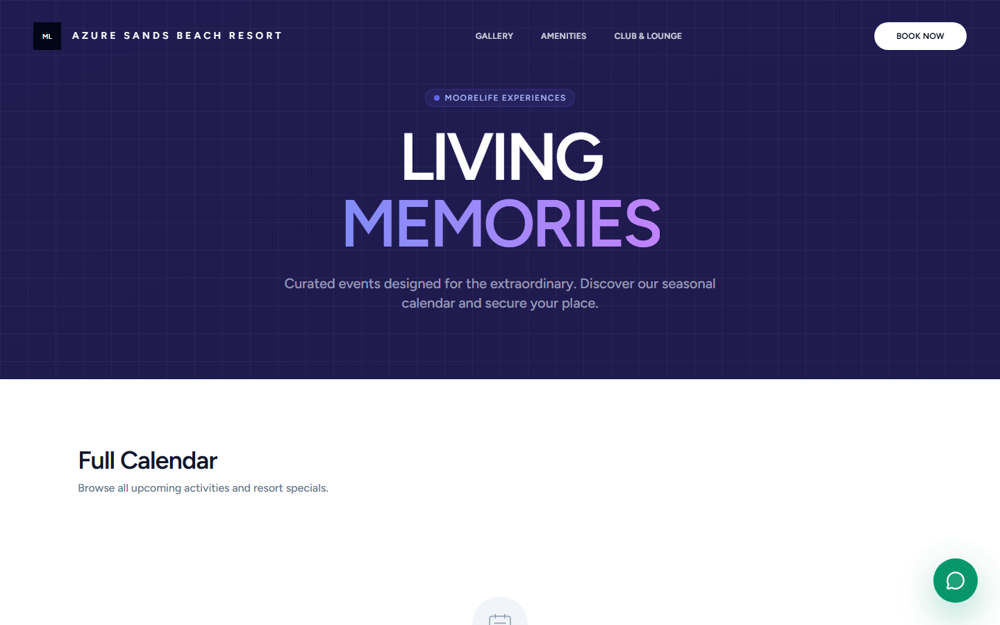

# HotelMS — Hotel, Resort & Club Operations Platform

> A full hotel operations system: reservations and front desk, housekeeping and department queues, QR-based room service, club POS, multi-gateway payments, HR-lite staff management, inventory, and an analytics layer for managers — plus an offline-capable front-desk terminal.

| | |
|---|---|
| **Role** | Solo — product design, architecture, backend, frontend, desktop terminal |
| **Timeline** | 2025 – 2026 · 578 commits |
| **Stack** | Laravel 12 · PHP 8.2+ · Vue 3 · Inertia.js · Tailwind CSS 4 · MySQL/MariaDB · PostgreSQL · Tauri 2 · Luau/Ziggy · PHPUnit |
| **Deployment** | Dockerised cloud deployment + on-premise LAN node for offline operation |

> **The source code for this project is private.** This repository is a technical case study with real screenshots from the running application. Code walkthroughs available on request.

---

## The problem

A resort does not run on one system. Reservations live in a booking tool, room service is taken over the phone, housekeeping uses a paper list, the club has its own till, and management reporting is assembled by hand every Monday. Guests see the seams.

HotelMS is an attempt to run the whole property from one data model — public website and booking flow on one end, and department-level operational queues on the other — while respecting a hard operational constraint: **the front desk cannot stop working when the internet does.**

---

## Product tour

### Manager operations console



The console is built around what a duty manager needs in the first thirty seconds: occupancy, available rooms, arrivals and departures today, plus an *action board* of pressure points — guest requests, maintenance tickets, cleaning backlog, unsettled stays. Everything on the board links into the filtered view that resolves it.

### Booking oversight



A reservation-to-checkout board with date reference, guest search, status filters, arrivals, in-house and unsettled-stay counters. Check-in, check-out, charge posting and price-override approvals are guarded actions with their own permission checks.

### Occupancy and reporting



Date-filtered occupancy reporting with a trend view and XLSX export. A deliberate design decision: the report states its own caveats inline ("0 occupied rooms, 72 rooms available now") instead of leaving the manager to guess what the number means.

### Staff directory



Staff records with role, department and position, filterable, with role-gated create and edit. Roles drive both navigation and API authorisation: `md`, `manager`, `frontdesk`, `housekeeping`, `laundry`, `kitchen`, `bar`, `inventory`, `staff`, `guest`.

### Inventory ledger



Stock is tracked **by location** (main store, housekeeping store) with per-item reorder thresholds, and every adjustment is a movement — add, use, transfer, reconcile. The "low stock" count is derived, not stored, so it cannot drift from reality.

### Guest-facing surfaces





The public site is part of the same product: a marketing site, gallery, club/lounge page with an events calendar and ticketing, and a booking flow (search → availability → room selection → guest details → review → payment) that writes into the same reservations model the front desk uses.

---

## What is in the system

### Reservations and front desk
- Availability search, room selection, guest details, review and payment steps
- Check-in / check-out with status transitions, in-house and unsettled-stay tracking
- Charges posted to a stay; discount codes; price-override approvals with an explicit approve/reject workflow
- QR-code room access with signed URLs, per-room QR generation, regeneration and invalidation

### Department operations
- **Room service**: guests scan a QR in the room to order; orders land in department-specific queues (kitchen, bar, laundry, housekeeping) with priority and status tracking
- Staff threads and internal notes per department
- Maintenance tickets, cleaning schedules and backlog tracking
- Guest feedback collection and a review queue for managers

### Commerce
- Multi-gateway payments: **Flutterwave and Paystack**, with initialisation, verification, webhook handling and reconciliation
- Tax calculation on bookings and orders, flexible pricing and promotional rates
- **Club POS** with its own product catalogue, roles and device registration
- Events and ticketing, including table reservations

### People and finance
- Staff records, departments, roles and permissions (Spatie-style role model with explicit route guards)
- HR surface: leave, onboarding, documents, policies, performance
- Finance dashboard and revenue reports, XLSX export

### Offline capability
- A **LAN sync node** so a property can keep working when the WAN link drops: the cloud remains the system of record, but terminals converge through a local node
- **Tauri 2 front-desk terminal** with pairing, a local database, and an explicit sync-scope manifest describing exactly which entities travel and in which direction
- A desktop release gate and auto-update design for field terminals

---

## Architecture

```
                    ┌─────────────────────────────────────────┐
   Public web  ───► │  Laravel 12 application                 │
   Guest QR    ───► │                                         │
                    │  routes/{public,admin,staff,hr,club,    │
                    │          finance,roomservice}.php       │
                    │  Controllers → Services → Models        │
                    │  Policies / role middleware             │
                    │  Inertia responses → Vue 3 pages        │
                    └───────────────┬─────────────────────────┘
                                    │
        ┌───────────────────────────┼───────────────────────────┐
        │                           │                           │
   ┌────▼─────┐              ┌──────▼──────┐             ┌──────▼──────┐
   │  MySQL / │              │  LAN sync   │             │  Payments   │
   │ Postgres │              │  node       │             │  Flutterwave│
   └──────────┘              └──────┬──────┘             │  Paystack   │
                                    │                    └─────────────┘
                             ┌──────▼───────┐
                             │ Tauri 2      │
                             │ front desk   │
                             │ terminal     │
                             │ (local DB)   │
                             └──────────────┘
```

### Notable engineering decisions

1. **One model, many surfaces.** Public booking, front desk, department queues and reporting all read and write the same reservations and orders model. No nightly export between systems.
2. **Route-level authorisation, not just UI hiding.** Every role boundary is enforced by middleware/policies; the UI merely reflects it.
3. **Derived operational state.** Occupancy, low stock and backlog counts are computed from facts (bookings, movements, tickets) rather than cached counters, which makes them auditable.
4. **Portability under constraint.** The app ran on shared hosting originally and was deliberately evolved to MySQL/MariaDB, then PostgreSQL, so the same codebase can be deployed on a cheap host or a LAN node.
5. **Offline terminal with an explicit sync scope.** Rather than syncing "everything", the desktop terminal declares a manifest of entities, directions and authority (e.g. booking authority partitioned between cloud and node) and reconciles against it.
6. **Payments are state machines.** Initialise → verify → webhook → reconcile, with booking status only advancing on verified payment, and audit rows for every transition.

---

## Testing and quality

- PHPUnit feature and unit suites covering booking lifecycle, payment verification, role boundaries and inventory movements
- Dedicated E2E SQLite database for walkthrough tests (`database/e2e.sqlite`) and a production walkthrough script
- Playwright end-to-end runs for critical paths (booking → payment → check-in)
- Written ADRs and phase plans under `docs/superpowers/` (booking authority partition, sync scope, desktop release gate, walkthrough remediation)

---

## Status

Operating as a complete hotel/club platform with an offline terminal track in active development. The next milestones are hardening the LAN-node convergence story and the desktop auto-update pipeline.

---

## Why this project is representative

HotelMS is where I learned to hold a large domain model together across many entry points — public site, guest QR flows, department queues, finance and a desktop terminal — without letting the seams show. It is also the project where I stopped treating tests and written specs as overhead: the walkthrough and sync designs are what made a system this wide possible to change safely.
