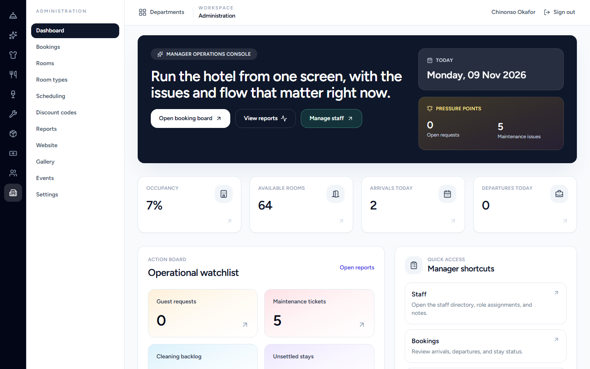
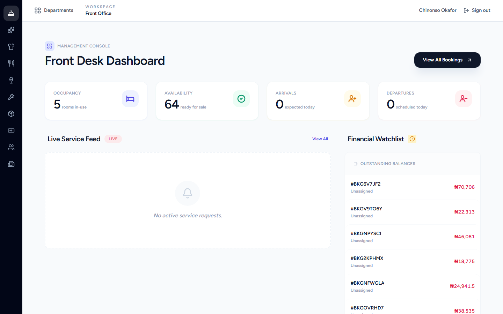
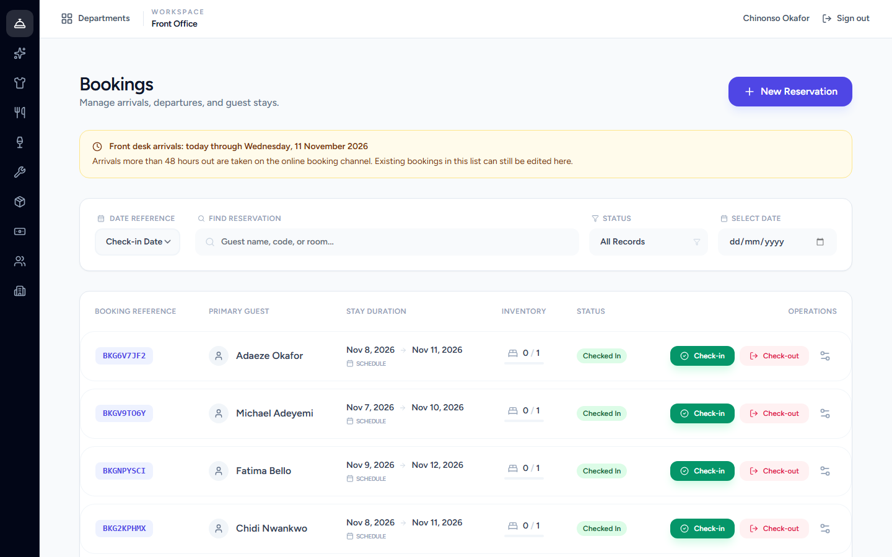
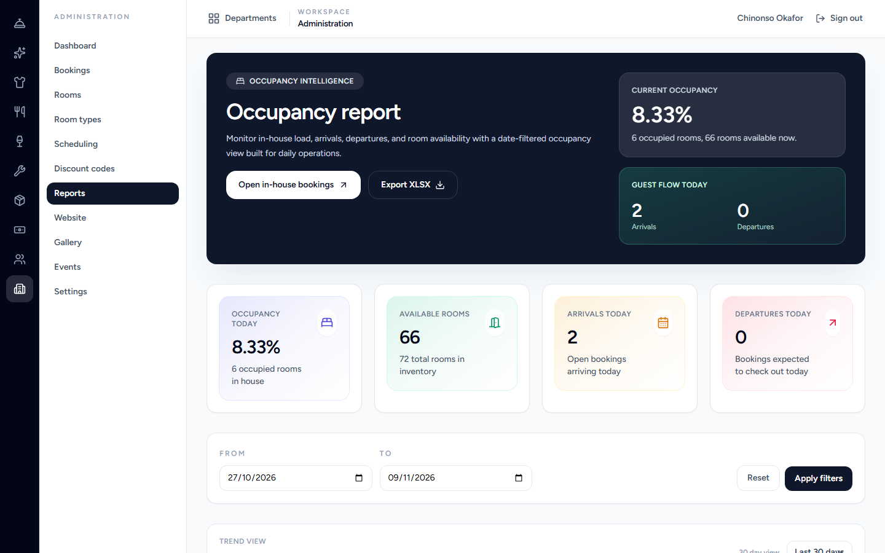
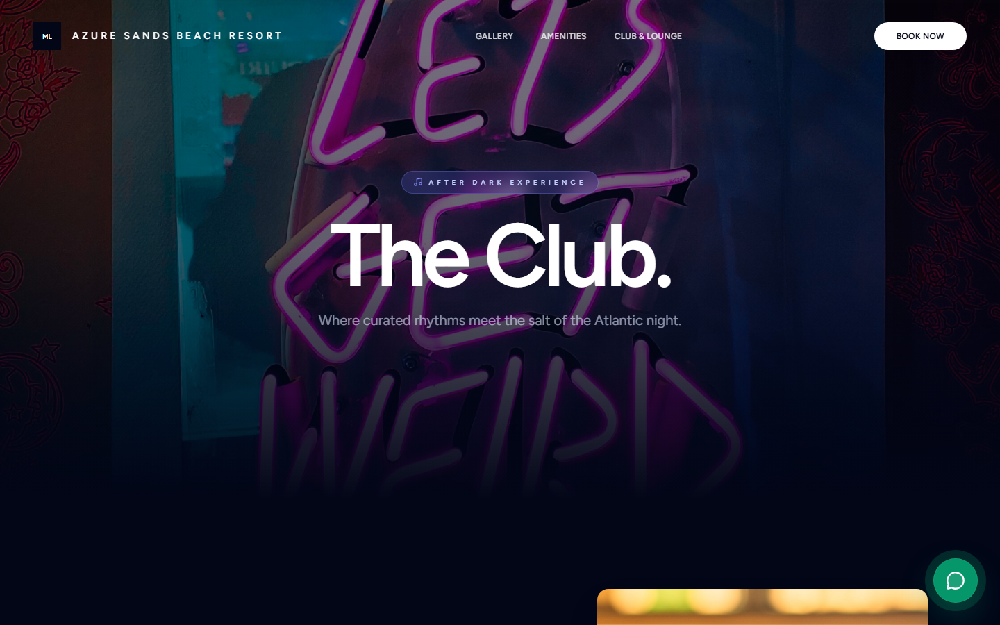
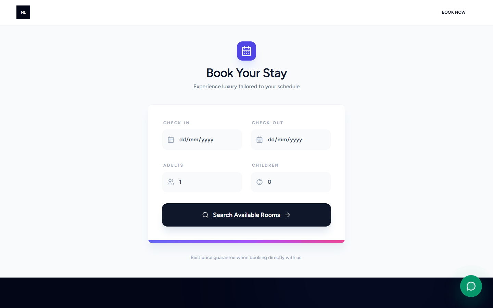

# HotelMS — Hotel, Resort & Club Operations Platform

> A full hotel operations system: reservations and front desk, department workspaces for every team, QR-based room service, club POS, multi-gateway payments, HR-lite staff management, inventory, and an accounting layer for managers — packaged as an installable desktop server with annual licensing.

| | |
|---|---|
| **Role** | Solo — product design, architecture, backend, frontend, desktop packaging, licensing |
| **Timeline** | 2025 – 2026 · 647 commits |
| **Stack** | Laravel 12 · PHP 8.4 · Vue 3 · Inertia.js · Tailwind CSS 4 · MySQL/MariaDB · PostgreSQL · Tauri 2 · PHPUnit · Playwright |
| **Deployment** | Dockerised cloud deployment, or a bundled on-premise installer (app + runtime + PostgreSQL) |
| **Commercial model** | 30-day trial, annual per-property licence, offline-verified |

> **The source code for this project is private.** This repository is a technical case study with real screenshots from the running application. Code walkthroughs available on request.

---

## The problem

A resort does not run on one system. Reservations live in a booking tool, room service is taken over the phone, housekeeping works from a paper list, the club has its own till, and management reporting is assembled by hand every Monday. Guests see the seams.

Two constraints shaped the design:

1. **Every department needs a different app.** A housekeeper needs a room board, not a 28-item sidebar. A front-desk agent needs arrivals and billing, not payroll.
2. **The property cannot stop when the internet does.** A hotel on a weak WAN still needs to check guests in, take payment, and serve dinner.

HotelMS answers both: a department-first workspace shell over one shared data model, plus an offline-capable terminal track and a self-hosted install path that does not depend on a cloud connection at all.

---

## Product tour

### Department workspaces



The shell is now a **workspace rail plus contextual sub-navigation**. Each icon is a department (Front Office, Housekeeping, Laundry, Kitchen, Bar, Maintenance, Stores, Finance, People, Administration, Platform); the second column shows only that workspace's modules. A user with access to more than one department gets a department picker after login; access is explicit per user in the database and enforced by middleware, not by hiding links.

Routes are workspace-prefixed (`/d/front-office/bookings`, `/d/finance/reports/profit-loss`) while route **names** stayed stable, so the 600-plus-commit codebase moved under a new URL scheme without rewriting every controller and test.

### Front desk



Occupancy, availability, arrivals and departures plus a **live service feed** and a **financial watchlist** of unsettled stays. The desk sees what needs action, not a chart of last month.



The booking board carries a front-desk cutoff rule with an explicit explanation ("arrivals more than 48 hours out are taken on the online channel"), date-reference switching, guest search, status filters, and guarded check-in / check-out actions.

### Stores and inventory


Stock is tracked **by location** with per-item reorder thresholds, and every change is a movement — add, use, transfer, reconcile. Low-stock counts are derived, never stored, so they cannot drift from the ledger.

### People


Staff records with role, department and position, filterable, with role-gated create and edit. Roles drive both navigation and route authorisation.

### Reporting



Date-filtered occupancy with a trend view and XLSX export. The report states its own caveats inline ("6 occupied rooms, 66 rooms available now") instead of leaving the manager to guess what the number means.

### Guest-facing surfaces






The public site is part of the same product: marketing pages, gallery, club/lounge with an events calendar and ticketing, and a booking flow (search → availability → room selection → guest details → review → payment) writing into the same reservations model the front desk uses.

---

## What is in the system

### Reservations and front desk
- Availability search, room selection, guest details, review and payment steps
- Check-in / check-out with status transitions, in-house and unsettled-stay tracking
- Charges posted to a stay, discount codes, price-override approvals with an approve/reject workflow
- QR-code room access with signed URLs, per-room QR generation, regeneration and invalidation
- Front-desk cutoff policy on how far ahead the desk may book

### Department operations
- **Room service**: guests scan a QR in the room to order; tickets land in department queues (kitchen, bar, laundry, housekeeping) with priority and status
- Housekeeping room board and cleaning templates; maintenance tickets; laundry handling
- Staff threads and internal notes per department
- Guest feedback collection with a manager review queue

### Commerce and finance
- Multi-gateway payments (**Flutterwave and Paystack**) with initialisation, verification, webhooks and reconciliation
- Tax calculation on bookings and orders; flexible pricing and promotions
- **Club POS** with its own catalogue, roles, shifts and stock, and **settled POS sales posted to the ledger**
- Accounting periods, chart of accounts, profit & loss, balance sheet, daily revenue and outstanding balances — with CSV/XLSX exports
- Events and ticketing, including table reservations

### HR and people
- Staff records, departments, roles and permissions with explicit per-user department access
- Leave, onboarding, documents, policies and performance surfaces

### Licensing and distribution
- **Annual licence per property** after a 30-day trial; one licence covers the server and every paired terminal and staff client
- Licences are **signed with an RSA private key on the licence server** and verified offline by the app using an embedded public key — an installed copy cannot mint its own licence
- Licence keys stored only as SHA-256 hashes; pricing bands are data, editable by the superuser, in NGN or USD
- Self-service licence move to a replacement PC
- Signed auto-update for the desktop app, and a **bundled installer** that ships the application, runtime and PostgreSQL together, with an in-place upgrade test

### Offline capability
- A **LAN sync node** so a property keeps working when the WAN link drops
- **Tauri 2 front-desk terminal** with pairing, a local database, and a sync-scope manifest declaring which entities travel in which direction with which authority
- Desktop release gate and auto-update design for field terminals

---

## Architecture

```
                    ┌─────────────────────────────────────────┐
   Public web  ───► │  Laravel 12 application                 │
   Guest QR    ───► │                                         │
                    │  Workspace registry → route groups      │
                    │  /d/{workspace}/...                     │
                    │  Controllers → Services → Models        │
                    │  Policies · role middleware ·           │
                    │  per-user department access             │
                    │  Inertia responses → Vue 3 pages        │
                    └───────────────┬─────────────────────────┘
                                    │
        ┌───────────────────────────┼───────────────────────────┐
        │                           │                           │
   ┌────▼─────┐              ┌──────▼──────┐             ┌──────▼──────┐
   │  MySQL / │              │  LAN sync   │             │  Payments   │
   │ Postgres │              │  node       │             │  Flutterwave│
   └──────────┘              └──────┬──────┘             │  Paystack   │
                                    │                    └─────────────┘
                             ┌──────▼───────┐   ┌────────────────────┐
                             │ Tauri 2      │   │ Licence server     │
                             │ front desk   │◄─►│ (RSA-signed,       │
                             │ terminal     │   │  offline verify)   │
                             └──────────────┘   └────────────────────┘
```

### Engineering decisions worth calling out

1. **Workspace as the navigation and security primitive.** One config file defines each workspace's department, roles, landing route and modules; the rail, the picker, the command index and the route middleware all read from it. The UI and server cannot disagree.
2. **Per-user department access, not role-as-department.** A user belongs to departments explicitly, backfilled from roles on migration, so a manager can be given Finance without also seeing HR.
3. **Stable route names, new URLs.** Moving to `/d/{workspace}` was a routing change, not a rewrite — tests and controllers kept addressing routes by name.
4. **Licensing that works offline.** Signing on the server, verifying in the binary. The installed app never needs to phone home and cannot forge a key.
5. **Ship the database with the app.** A hotel installer that requires a DBA is not an installer. Bundling PostgreSQL and testing an in-place upgrade is what makes on-premise viable.
6. **Derived operational state.** Occupancy, low stock and backlog are computed from facts (bookings, movements, tickets) rather than cached counters, which keeps them auditable.
7. **POS close means posting.** A settled club sale writes to the ledger, so the till and the accounts cannot silently diverge.

---

## Testing and quality

- PHPUnit feature tests across booking lifecycle, payment verification, role boundaries, inventory movements and report/export round-trips
- Dedicated E2E database (`database/e2e.sqlite`) and a scripted production walkthrough covering guest surface, POS lifecycle, reports, finance, HR and inventory
- Route-level access tests for the workspace move, including negative cases for department access and navigation shells
- Playwright end-to-end runs for critical paths (booking → payment → check-in)
- Written ADRs, specs and phase plans under `docs/superpowers/` (department workspaces, booking authority partition, sync scope, desktop release gate)

---

## Status

Operating as a complete hotel/club platform. Recent work: department workspaces, the licensing desk, the bundled installer with signed auto-update, and POS-to-ledger posting. Known follow-ups are tracked in the repository — including finishing the department picker on the current branch and extending the workspace docs.

---

## Why this project is representative

HotelMS is where I learned to hold a large domain model together across many entry points — public site, guest QR flows, department workspaces, finance, and a desktop terminal — without letting the seams show. It is also the project where product packaging became part of the engineering: licensing, installers and updates are designed and tested like features, because for a hotel they are the difference between software and a working front desk.
